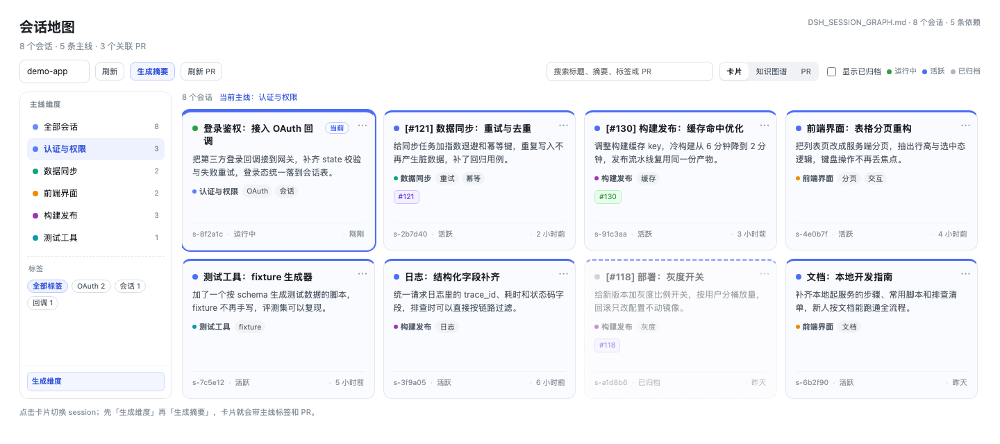
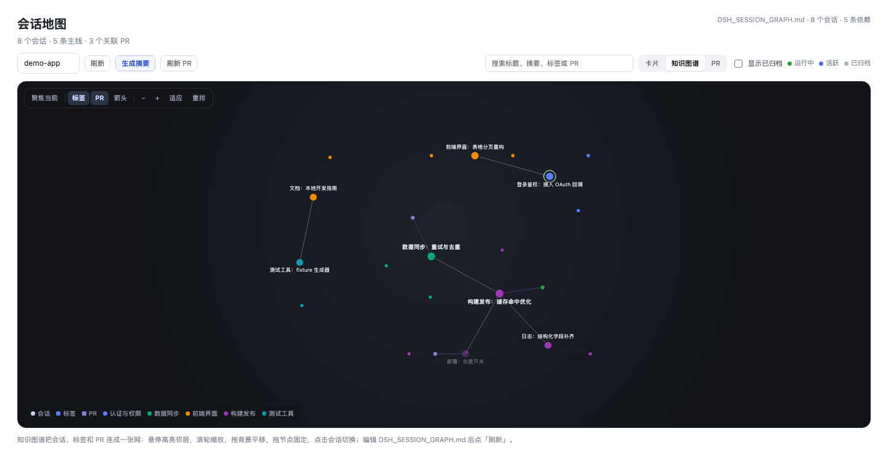

# dsh-session-graph

DSH Web 插件：把选中项目的 DSH 会话铺成一张「会话地图」——按主线维度、标签和 PR 展示卡片，
并提供一张 Obsidian 风格的知识图谱，以及 `/summarize-*` 命令，把会话整理成项目根目录的
`DSH_SESSION_GRAPH.md`。





## 功能

- **卡片视图**：每个会话一张卡片，显示模型写的中文标题/摘要、主线维度标签、关联 PR、运行/归档状态；
  点卡片切换会话，「⋯」打开会话菜单。
- **知识图谱**：参考 Obsidian Graph View，用斥力/弹簧布局把会话、标签和 PR 铺成一张网；
  悬停高亮邻居、滚轮缩放、拖动节点、聚焦当前会话，用来回看任务之间的依赖和归属关系。
- **PR 视图**：项目 PR 目录，可只看有会话关联的 PR，也可看全部。
- **维度筛选**：左侧按项目主线维度、标签过滤，未分类会话单独一档。
- **摘要命令**：生成维度、生成摘要、刷新 PR、单独总结，由 Host 侧命令执行，面板上点按钮即可。

## 安装

```bash
# 从 npm 安装
dsh plugin --profile web add dsh-session-graph

# 或从本地目录 / git 仓库安装
dsh plugin --profile web add link:/path/to/dsh-session-graph
dsh plugin --profile web add github:<user>/dsh-session-graph
```

装好后重启 DSH Web（或刷新页面）即可在侧栏看到入口。

### 依赖

| 依赖 | 用途 | 是否必需 |
|---|---|---|
| DSH 0.2.x | 宿主、会话存储、凭据 | 必需 |
| Python 3.10+ | `/summarize-*` 命令执行 `summarize_sessions.py` | 摘要功能必需 |
| `gh`（已登录） | 拉取项目 PR 目录 | 可选；没有则只保留会话里出现的 PR 链接 |
| `zstd` | 会话日志兜底读取（`turnOutline` 缺失时） | 可选 |

Python 解释器可用 `DSH_SUMMARY_PYTHON` 指定，默认 `python3`。

## 数据文件

插件读取**当前选中项目**根目录的 `DSH_SESSION_GRAPH.md`；摘要命令会写入同一个文件。
文件是一段可手改的 JSON：

```json
{
  "version": 3,
  "title": "项目名",
  "repo": "owner/repo",
  "taxonomy": {
    "dimensions": [
      { "id": "video-labeling", "name": "视频标注", "tags": [ { "id": "label-prompt", "name": "标注提示词" } ] }
    ],
    "updatedAt": "2026-11-12T12:00:06+00:00"
  },
  "pullRequests": [ { "number": 604, "title": "...", "url": "...", "state": "MERGED" } ],
  "sessions": [
    {
      "session": "session-<uuid>",
      "title": "General 标注：收紧提示词",
      "summary": "收紧 General 标注口径并新增无视角档。",
      "dimensions": { "video-labeling": ["label-prompt"] },
      "pullRequests": [604],
      "dependsOn": [],
      "summarizedSeq": 631,
      "summarizedTaxonomy": "2026-11-12T12:00:06+00:00"
    }
  ]
}
```

- `dimensions`：会话 → 「维度 id → 标签 id 列表」；一个会话可以属于多个维度；
- `pullRequests`：项目 PR 目录（元数据用）；`sessions[].pullRequests` 是该会话关联的编号；
- `summarizedSeq` / `summarizedTaxonomy`：摘要书签，记录生成时该会话的序号和维度版本，
  用来跳过没变化的会话；删掉这两个字段会让该会话下次重做一次；
- 卡片标题会自动加 `[#604]` 前缀（多个 PR 显示前两个，更多追加 `[+N]`）；
- `title` / `summary` 可以手改，点面板「刷新」即可生效。

## 知识图谱

「知识图谱」不再按依赖画左右分层的思维导图，而是像 Obsidian 的 Graph View 一样，用斥力、
弹簧和碰撞把节点铺开。图谱完全由现有数据推导，不需要新增字段：

- **节点**：会话（按主线维度着色，圆点大小随连接数变化）、标签（`#tag`）、PR（`#123`）；
- **连线**：`sessions[].dependsOn` 依赖、会话 → 标签归属、会话 → PR 关联；工具栏可分别开关
  标签、PR 和依赖箭头；
- **交互**：滚轮以指针为中心缩放，拖背景平移，拖节点固定，悬停高亮一跳邻居并压暗其它节点；
  点击会话切换 session，右键会话打开菜单，点击 PR 在 GitHub 打开；
- **视图控制**：`适应` 重新框选全部节点，`重排` 重新跑力导向布局，`聚焦当前` 只显示当前
  会话两跳以内的节点和连线（对应 Obsidian 的 local graph）；
- **标签密度**：缩小时只保留会话标签，标签/PR 标签在放大或悬停时显示；搜索框和卡片视图的
  主线/标签筛选同样作用于图谱。

## 命令

面板按钮与命令一一对应，也可以直接在对话里执行：

| 按钮 | 命令 | 行为 | 费用 |
|---|---|---|---|
| 生成维度 | `/summarize-taxonomy` | 拉 PR + 生成 4-6 条主线维度与标签 | 1 次模型调用 |
| 生成摘要 | `/summarize-project` | 只重做有更新的会话，写摘要/标签并推断依赖 | 每个有更新的会话 1 次 + 有更新时 1 次关系 |
| 刷新 PR | `/summarize-prs` | 只刷新项目 PR 目录 | 免费 |
| 卡片「⋯」→ 单独总结 | `/summarize-session` | 只更新该会话 | 有更新时 1 次模型调用 |

几点行为约定：

- **增量**：会话没有新事件、维度也没变时直接跳过；`/summarize-session --force` 可强制重做；
- **标题回写**：摘要改写了标题后，面板会把卡片上显示的新标题同步回 DSH session（`session.rename`，包含 `[#PR]` 前缀），左侧 session 列表随之更新；项目摘要只同步本次真正改过的标题，单独总结还会校准该会话已有的标题差异，不会批量重命名其他历史条目；
- **依赖**：只在有会话被重写、或还有条目缺 `dependsOn` 时重新推断；
- **归档冻结**：已归档会话不参与摘要和关系推断，但它们的标题/摘要仍参与维度归纳；
- **PR 关联**：来源依次是 turns 里的 PR URL、`PR #123` 文本、PR head branch 名、摘要里的 `PR #123`；
- **不监听文件变化**：手改 `DSH_SESSION_GRAPH.md` 后点面板「刷新」。

## 模型与凭据

摘要脚本默认走 DSH 的默认模型路由：`deepseek-official` / `deepseek-flash`
（`https://api.deepseek.com/anthropic`，Anthropic Messages 协议）。

- 凭据优先级：`$DSH_HOME/.credentials.yaml` 的 `refs.DEEPSEEK_API_KEY` → 同名环境变量；
  `$DSH_HOME` 未设置时按 DSH 的默认值 `~/.dsh`；
- 换模型/端点：`--base-url` / `--model` / `--api-key-env`，或用
  `DSH_SUMMARY_BASE_URL` / `DSH_SUMMARY_MODEL` / `DSH_SUMMARY_API_KEY_ENV`；
- 脚本只打印模型、端点和 key 来源，不打印 key 本身。

更多 PR 关联规则见 `lib/summarize_sessions.py` 顶部的说明。

## 本地开发

```bash
npm test        # 客户端 bundle + Host 命令注册
node --check lib/client.js

# 手动跑摘要脚本（默认 dry-run：不调模型、不写文件）
python3 lib/summarize_sessions.py --mode sessions --max-sessions 5 --no-prs
```

### 截图（仓库内）

README 里的 `preview.png` 和 `preview-graph.png` 由本仓库自己的脚本生成，**不读取任何真实会话数据**：

```bash
npm run screenshots     # 用 screenshots/demo.json 的假数据 + 面板真实 CSS 截卡片和图谱两张图
```

- `screenshots/demo.json`：示例项目、维度、卡片、PR 和 `dependsOn`，全部是假数据，改这里就能换文案/布局；
- `screenshots/build.mjs`：从 `lib/client.js` 提取面板 CSS，拼卡片页静态 HTML，再用无头 Chrome 截图；
- `screenshots/graph.mjs`：在 Node 里加载真实 bundle，复用 `buildKnowledgeGraph` / `tickGraph` /
  `seedGraphPosition` 跑力导向布局，再生成知识图谱截图；
- `screenshots/capture.mjs`：通过 CDP 精确设置 `width x height` 视口后截图，避免 macOS 无头 Chrome 的窗口缩放问题；
- 需要本机有 Chrome / Chromium / Edge，或用 `CHROME=/path/to/chrome npm run screenshots` 指定；
- 只改样式不动数据时，重跑一次就能让预览跟上，不需要开 DSH；
- `screenshots/` 只在仓库里，不随 npm 包发布（`files` 不含它）。

## 已知限制

- 依赖 DSH 0.2.x 的会话缓存格式（`storages/session_projcache`），DSH 大版本升级可能要跟着改；
- 会话与项目按 `cwd` 归属，worktree 里的会话也算在同一个项目下；
- 面板靠点按钮刷新，不监听文件变化；
- 图谱的力导向布局是 O(n²) 的简洁实现，上百个会话够用；特别大的项目需要 Barnes–Hut 或图虚拟化；
- 密集区域里节点标签仍可能重叠（已做上下交替和缩小时隐藏），也没有 Obsidian 的悬浮预览面板；
- 还没有会话 URL 路由，点卡片只切换当前会话。

## License

MIT
